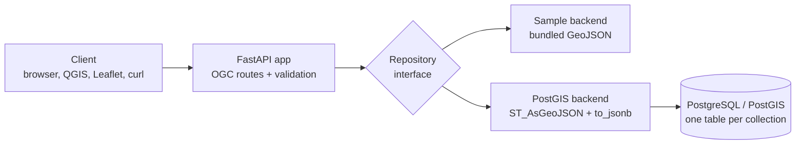

# geospatial-api-reference — OGC API – Features with FastAPI and PostGIS

## Who this is for

Backend developers and data engineers building OGC-compliant geospatial APIs.

[](https://github.com/ZQM-Computing/geospatial-api-reference/actions)

A reference implementation of **OGC API – Features** (the modern successor to WFS) built with **FastAPI** and **PostgreSQL/PostGIS**: serve vector geospatial data as **GeoJSON** over REST — collections, items, `bbox` and `datetime` filtering, and pagination — with the architecture decisions documented, not just the code.

It runs two ways:

- **Sample mode (zero infrastructure):** serves a bundled synthetic GeoJSON dataset from memory. The whole test suite runs in this mode.
- **PostGIS mode:** serves live tables from PostGIS, generating GeoJSON in SQL with `ST_AsGeoJSON` and `to_jsonb`. Switch with one environment variable.

## Quick start

```bash
git clone https://github.com/ZQM-Computing/geospatial-api-reference.git
cd geospatial-api-reference
pip install -r requirements.txt
uvicorn app.main:app --reload
```

Then:

```bash
curl http://localhost:8000/collections
curl "http://localhost:8000/collections/service-sites/items?bbox=-81.15,29.18,-80.95,29.35"
curl http://localhost:8000/collections/parcels/items/parcel-2
```

Interactive OpenAPI docs are at `http://localhost:8000/docs`.

### Full stack with Docker (API + PostGIS)

```bash
docker compose up --build
```

Compose starts PostGIS, loads `sql/schema.sql` (the same synthetic data as the sample file), and starts the API in PostGIS mode on <http://localhost:8000>.

## Endpoints

| Endpoint | Description |
|---|---|
| `GET /` | Landing page with links (OGC Core) |
| `GET /conformance` | Conformance classes this service declares |
| `GET /collections` | All collections with spatial extents |
| `GET /collections/{id}` | One collection's metadata |
| `GET /collections/{id}/items` | GeoJSON FeatureCollection — supports `bbox`, `datetime`, `limit`, `offset` |
| `GET /collections/{id}/items/{featureId}` | One feature as GeoJSON |
| `GET /healthz` | Liveness probe |

`datetime` accepts an instant (`2026-02-01T00:00:00Z`) or an interval (`2026-02-01T00:00:00Z/2026-02-28T23:59:59Z`, `../2026-02-01T00:00:00Z` for open ends), per the OGC standard.

## Architecture



The one idea worth stealing: **the HTTP layer never touches SQL or files.** Both backends implement the same small repository contract (`list_collections`, `query_items`, `get_item`), so the demo runs anywhere, the tests need no database, and the production path swaps in without route changes. In PostGIS mode, geometry is serialized in the database (`ST_AsGeoJSON`) and properties via `to_jsonb(row) - 'geom'` — add a column to a table and it appears in the API's properties automatically.

More on how the endpoints map to the standard — and what's deliberately out of scope (transactions, CQL2, tiles) — in [`docs/ogc-notes.md`](docs/ogc-notes.md).

## Configuration

Environment variables (prefix `GEOAPI_`):

| Variable | Default | Meaning |
|---|---|---|
| `GEOAPI_DATA_BACKEND` | `sample` | `sample` or `postgis` |
| `GEOAPI_DATABASE_URL` | local demo URL | PostgreSQL connection string (PostGIS mode) |
| `GEOAPI_DEFAULT_LIMIT` | `50` | Default page size for items queries |
| `GEOAPI_MAX_LIMIT` | `500` | Hard ceiling on `limit` |

## Tests

```bash
pip install -r requirements-dev.txt
pytest
```

The suite exercises the landing page, conformance, collections, bbox/datetime filtering, pagination, single-item retrieval, and error cases — all against the sample backend, so it runs in CI with no services.

## Repository layout

```text
.
├── app/
│   ├── main.py         # FastAPI app: OGC routes
│   ├── config.py       # pydantic-settings configuration
│   └── repository.py   # sample + PostGIS backends behind one interface
├── data/               # bundled synthetic GeoJSON (sample mode)
├── sql/schema.sql      # PostGIS schema + the same sample data
├── tests/              # pytest suite (no database required)
├── docs/ogc-notes.md   # standard mapping + production checklist
├── Dockerfile
└── docker-compose.yml  # API + PostGIS full stack
```

## Data note

All features are synthetic. Coordinates fall around Volusia County, Florida for realism; nothing here represents real property, infrastructure, or people.

## Companion repository

Database-side patterns — indexing, spatial joins, tiling with `ST_AsMVT`, data quality, partitioning — live in [postgis-patterns](https://github.com/ZQM-Computing/postgis-patterns). This repo is the serving layer on top of the same ideas.

## Maintainer

Maintained by [ZQM Computing](https://github.com/ZQM-Computing). Built from production geospatial platform and REST API work by Alex Zelenski, GISP.

## More from this series

- [postgis-patterns](https://github.com/ZQM-Computing/postgis-patterns) — Production PostGIS patterns: spatial indexing, joins & KNN, SRID management, vector tiles, data quality, partitioning
- [duckdb-spatial-patterns](https://github.com/ZQM-Computing/duckdb-spatial-patterns) — DuckDB Spatial patterns for analytical geospatial SQL: GeoParquet, spatial joins, KNN, H3 aggregation — no server required
- [qgis-resources](https://github.com/ZQM-Computing/qgis-resources) — QGIS expressions, PyQGIS snippets, Processing scripts, styles, and QField field-collection guides
- [ollama-fleet-patterns](https://github.com/ZQM-Computing/ollama-fleet-patterns) — Ollama fleet operations: model management, health checks, load-spreading, VRAM budgeting, dependency-light RAG
- [proxmox-ceph-operations](https://github.com/ZQM-Computing/proxmox-ceph-operations) — Proxmox VE + Ceph operations runbooks: health checks, backup discipline, OSD replacement, upgrade checklists

## License

MIT — see [`LICENSE`](LICENSE).

## Related repositories

- [geospatial-patterns](https://github.com/ZQM-Computing/geospatial-patterns) — umbrella index of all geospatial pattern repos
- [gdal-patterns](https://github.com/ZQM-Computing/gdal-patterns) — GDAL/OGR CLI patterns for raster/vector conversion
- [geopandas-patterns](https://github.com/ZQM-Computing/geopandas-patterns) — GeoPandas/Shapely patterns for Python geospatial workflows
- [pgrouting-patterns](https://github.com/ZQM-Computing/pgrouting-patterns) — pgRouting patterns for PostGIS network analysis
- [stac-patterns](https://github.com/ZQM-Computing/stac-patterns) — STAC patterns for geospatial data discovery
- [cog-patterns](https://github.com/ZQM-Computing/cog-patterns) — Cloud Optimized GeoTIFF patterns
- [maplibre-patterns](https://github.com/ZQM-Computing/maplibre-patterns) — MapLibre GL JS patterns for frontend vector tiles
- [geoparquet-patterns](https://github.com/ZQM-Computing/geoparquet-patterns) — GeoParquet patterns for columnar analytics
- [h3-patterns](https://github.com/ZQM-Computing/h3-patterns) — H3 hexagonal grid patterns

*Part of [ZQM Labs](https://github.com/ZQM-Labs) — games, gear & a little mischief.*
